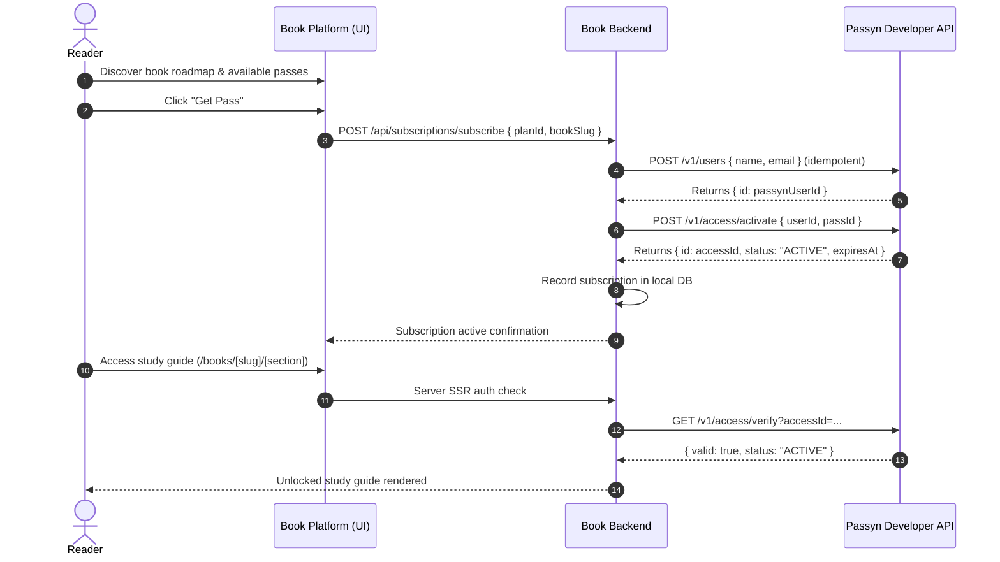

# Passyn Subscription Management Integration Guide

This document details the architecture, configuration, subscription lifecycle, webhook mechanisms, and access control implemented for the ReadBooks platform powered by **Passyn Developer API**.

---

## 1. Integration Architecture

The subscription management follows a decoupled, secure server-to-server architecture:

```
┌─────────────────────────────────┐
│     Book Platform Frontend      │
│  (Astro SSR / Client Hydration) │
└──────────────┬──────────────────┘
               │ Secure Session Cookie (HttpOnly)
               ▼
┌─────────────────────────────────┐
│     Book Platform Backend       │
│  - Auth & Session Service       │
│  - Pass & Access Control Engine │
│  - Local Database (SQLite/WAL)  │
│  - Webhook Ingestion Engine     │
└──────────────┬──────────────────┘
               │ Server-side Bearer Auth (pk_test_... / pk_live_...)
               ▼
┌─────────────────────────────────┐
│      Passyn Developer API       │
│   (Passes, Access, Webhooks)    │
└─────────────────────────────────┘
```

### Security Isolation
- **No Client-Side Secrets**: All communication with the Passyn Developer API occurs exclusively from the server-side Node runtime (`src/lib/passyn/client.ts`). The `PASSYN_API_KEY` and `PASSYN_WEBHOOK_SECRET` are never bundled into client scripts.
- **Backend-Enforced Authorization**: Viewing protected book study guides (`/books/[slug]/[section]`) is guarded on the server. Unsubscribed users receive an access paywall with plan selection rather than the protected markdown content.

---

## 2. Passyn Developer API Mapping

The Book platform communicates with the following Passyn endpoints:

| Passyn Endpoint | HTTP Method | Scope | Purpose |
| :--- | :---: | :--- | :--- |
| `/v1/users` | `POST` | `users:write` | Idempotently provision or retrieve customer in Passyn before pass activation. |
| `/v1/passes` | `POST` | `passes:write` | Create a book pass (`name`, `durationHours`, `price`, `type`, `isActive`). |
| `/v1/passes` | `GET` | `passes:read` | List passes. |
| `/v1/passes/:id` | `PATCH` | `passes:write` | Toggle pass status or update pricing. |
| `/v1/passes/:id` | `DELETE` | `passes:write` | Soft-delete / archive a pass. |
| `/v1/access/activate` | `POST` | `access:write` | Issue and activate access for `{ userId, passId }` upon subscription purchase. |
| `/v1/access/verify` | `GET` | `access:read` | Hot-path access verification query (`userId`, `passId`, or `accessId`). |
| `/v1/access/revoke` | `POST` | `access:write` | Revoke pass access upon customer or administrator cancellation. |
| `/v1/access/history` | `GET` | `access:read` | Query historical accesses for user. |
| `/v1/webhooks` | `POST` | `webhooks:write` | Register webhook endpoint for real-time lifecycle synchronization. |

---

## 3. Subscription Plans Model

Plans represent time-bounded or custom access rights to specific books:

- **Attributes**:
  - `id`: Local plan identifier (e.g., `plan_...`).
  - `book_slug`: Associated technical book (e.g. `introduction-to-linear-algebra`).
  - `passyn_pass_id`: Synced Passyn Pass identifier (e.g. `pass_...`).
  - `name`: Display title (e.g. `24-Hour Intensive Pass`, `7-Day Study Sprint`).
  - `price` & `currency`: Major units (e.g. `4.99`, `USD`).
  - `duration_hours`: Access duration in hours (e.g., 24, 168, 720).
  - `pass_type`: Passyn pass type (`DAY`, `WEEKLY`, `CUSTOM`, `EXAM`, `PROJECT`).
  - `is_active`: Published state flag.

---

## 4. Customer Subscription Lifecycle



---

## 5. Webhook Integration & Verification

The Book platform ingests asynchronous events at `/api/webhooks/passyn`.

### Signature Verification
Deliveries carry the `Passyn-Signature` header:
```
Passyn-Signature: t=1765459200,v1=<hex hmac-sha256(secret, "${t}.${rawBody}")>
```

1. **Replay Protection**: The timestamp `t` is verified against current server time: requests with `|now - t| > 300` seconds are rejected.
2. **Constant-Time Comparison**: HMAC-SHA256 signature is verified using `crypto.timingSafeEqual` against `PASSYN_WEBHOOK_SECRET`.
3. **Idempotency**: Every event ID is logged in the `webhook_events` table. Redelivered events are recognized and return 200 without executing duplicate actions.

### Supported Events
- `pass.activated` / `pass.purchased`: Updates local subscription to `ACTIVE`, records `activated_at` and `expires_at`.
- `pass.expired`: Marks local subscription as `EXPIRED`.
- `pass.revoked`: Marks subscription as `REVOKED` and stores `revoke_reason`.
- `settlement.paid`: Logged to audit trail.

---

## 6. Access Control Enforcement

Access to protected study guides is enforced strictly on the server:

1. **Route Protection (`src/pages/books/[slug]/[section].astro`)**:
   - Executes `checkBookAccess(currentUser, bookSlug)`.
   - If user has an active pass or is `ADMIN`: full study guide markdown is rendered.
   - If user has no active pass or is unauthenticated: full content is omitted from HTML, and a native editorial paywall card is presented.
2. **IDOR & Ownership Protection**:
   - Subscriptions can only be cancelled or inspected by the subscriber who owns them, or an authenticated administrator.

---

## 7. Administrative Interface

Accessible at `/admin/subscriptions` (requires role `ADMIN`):

- **Plan Configuration**: Create new book passes (synced directly to Passyn via API), toggle active/inactive status, or archive passes.
- **Subscriber Directory**: Inspect all subscribers, their active passes, Passyn access IDs, activation dates, and expiration dates.
- **Access Revocation**: Manually revoke active passes with reason logging.
- **Event Audit Log**: Monitor incoming webhook payloads, signature delivery status, and execution errors.

---

## 8. Local Setup & Testing

### Prerequisites
- Node.js >= 20 (recommended: Node 22+ with native `node:sqlite`)
- Passyn deployment running locally (or test credentials)

### Environment Variables
Copy `.env.example` to `.env`:
```bash
cp .env.example .env
```
Populate the configuration:
```env
PASSYN_API_URL=http://localhost:3000/api
PASSYN_API_KEY=pk_test_...
PASSYN_WEBHOOK_SECRET=whsec_...
ADMIN_EMAIL=admin@readbooks.dev
ADMIN_PASSWORD=AdminPassword123!
```

### Running Tests
Execute the comprehensive test suite covering all 12 requirement scenarios:
```bash
npm run test
```

### Running Verification & Build
```bash
npm run verify
```

### Starting the Server
```bash
npm run build
node dist/server/entry.mjs
```
The server will bind to `http://localhost:4321`.
